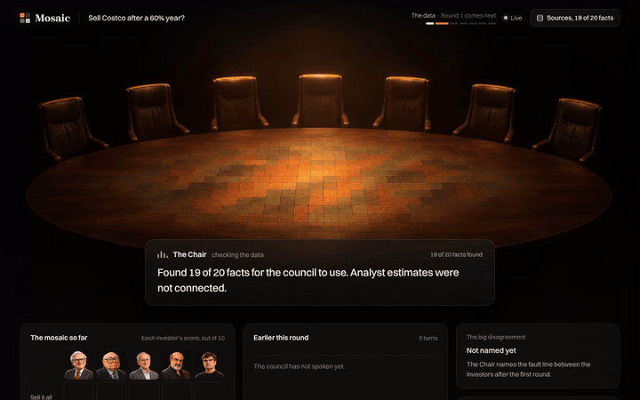

<div align="center">


# Mosaic

**Investing legends debate your decision.**

Simulated from their public work, with a scored verdict that shows where they disagree.<br>
Free plugin for Claude Code. Not investment advice.

[](LICENSE)
[](package.json)
[](#get-started)
[](https://github.com/abhinavuppal931/mosaic/actions/workflows/test.yml)


</div>

You describe a decision, such as buying, adding to, trimming or selling a stock. Simulated investors argue it over three rounds from one sourced fact sheet: seven by default, including Buffett, Marks, Taleb and Burry, from a roster of thirteen. You get a scored verdict that keeps their disagreements visible, with what could go wrong, what would change the call, and a date to check again. A local page, the Room, shows it all live.

## See it in action



**[Take the tour](docs/TOUR.md)**: first run, a live debate, the verdict, the journal, sharing and the phone view.

## Get started

You need [Claude Code](https://claude.com/claude-code) and [Node.js](https://nodejs.org) 20 or later. No API keys, no accounts.

**In your terminal** (Command Prompt, PowerShell or Terminal), run these two commands:

```bash
claude plugin install mosaic --marketplace abhinavuppal931/mosaic
```

```bash
claude "/mosaic"
```

The second command starts Claude Code and runs Mosaic. It checks your setup, opens the Room in your browser on a finished example council, and asks for your decision.

Next time, start Claude Code with `claude`, then type `/mosaic` **inside Claude Code**, at its `>` prompt, not in the terminal.

### Let your agent set it up

Paste this line into Claude Code, and it checks Node, installs Mosaic and opens the Room for you:

```
Read https://raw.githubusercontent.com/abhinavuppal931/mosaic/main/llms-install.md and follow it to set up Mosaic for me.
```

Using Codex, Cursor or another coding agent? Paste the same line. It opens the Room on the example councils and tells you how to get Claude Code, because a council of your own runs in Claude Code.

<details>
<summary>Install from a git clone instead</summary>

In your terminal, in the folder you want the code in:

```bash
git clone https://github.com/abhinavuppal931/mosaic.git
```

```bash
claude --plugin-dir mosaic "/mosaic"
```

`--plugin-dir` loads your copy of the code, so your edits apply the next time you start it. To open only the Room on the example councils, run `node mosaic/room/server.js --open` from the same folder.

</details>

## What you can ask

Type these **inside Claude Code**:

| You type | What happens |
|---|---|
| `/mosaic I plan to buy NVIDIA for a three-year hold` | A full council: three rounds of debate and a scored verdict, saved to your journal |
| `/mosaic <your decision> --quick` | A faster council with four investors |
| `/mosaic ask taleb <your question>` | One investor answers one question |
| `/mosaic recheck NVDA` | A quick council on what changed since your last verdict |
| `/mosaic journal` | Your saved decisions and when to look at each again |
| `/mosaic board` | Choose which investors sit on your council by default |
| `/mosaic room` | Open the Room |
| `/newseat <investor>` | Add an investor of your own, built from their public work |

It also stress-tests a thesis, reviews a portfolio for concentration and ruin risk, and takes macro questions such as rates, inflation and credit. [How it works](docs/HOW-IT-WORKS.md) explains the rounds, the scores and the verdict labels.

## FAQ

**Is this investment advice?** No. Mosaic grades how a decision was made, never the security. It sets no price targets and suggests no position sizes.

**Does it cost anything?** Mosaic is free. It runs on your Claude Code plan, and a full council uses three sub-agent runs per investor. `--quick` costs less.

**Do I need API keys?** No. It uses free public sources by default. Keys are optional and add more data: see [Data and keys](docs/DATA.md).

**What leaves my machine?** Only requests to public data sources such as SEC EDGAR, made while building the fact sheet. There is no telemetry. See [what Mosaic runs and sends](docs/HOW-IT-WORKS.md#what-mosaic-runs-and-sends).

**Are these the real investors?** No. Each is a simulation built from that investor's public work. It is not the person, is not affiliated with or endorsed by them, and does not speak for them.

**Where is my data?** In a `.mosaic` folder in your home folder, on any system.

## Troubleshooting

- **"'/mosaic' is not recognized"** (or `command not found`): you typed it in the terminal. Run `claude "/mosaic"` instead, or start `claude` and type `/mosaic` at its prompt.
- **"'claude' is not recognized"**: Claude Code is not installed. Install it from [claude.com/claude-code](https://claude.com/claude-code), then open a new terminal.
- **`unknown option '--marketplace'`**: your Claude Code is older than 2.1.292. Run `claude update`, or install in two steps: `claude plugin marketplace add abhinavuppal931/mosaic`, then `claude plugin install mosaic@mosaic`.
- **`/mosaic` does nothing right after installing**: in a session that was already open, type `/reload-plugins` first. If another plugin uses the name, type `/mosaic:mosaic`.
- **The Room's port 4731 is busy**: the Room moves to the next free port and prints its link.
- **Something else**: run `/mosaic` again. It starts with a setup check that names the problem and the fix.

## More

[Tour](docs/TOUR.md) · [How it works](docs/HOW-IT-WORKS.md) · [Data and keys](docs/DATA.md) · [Contributing](CONTRIBUTING.md) · [Security](SECURITY.md) · [Changelog](CHANGELOG.md)

Mosaic is made by Abhinav Uppal. More of his work is on [his website][site].

## Credits

Adapted from [Roast Room](https://github.com/nateherkai/roast-room) (MIT, AI Automation Society); see `NOTICE`. Ideas from [ai-hedge-fund](https://github.com/virattt/ai-hedge-fund) (MIT). Mosaic is MIT licensed.

> **Mosaic grades how a decision was made. It is not investment advice.** Every investor in it is a simulation built from that person's public work, not the person. Quotes appear only with a source. Numbers carry their as-of dates; check them against the filings before acting.

[site]: https://abhinav-uppal-website.vercel.app
