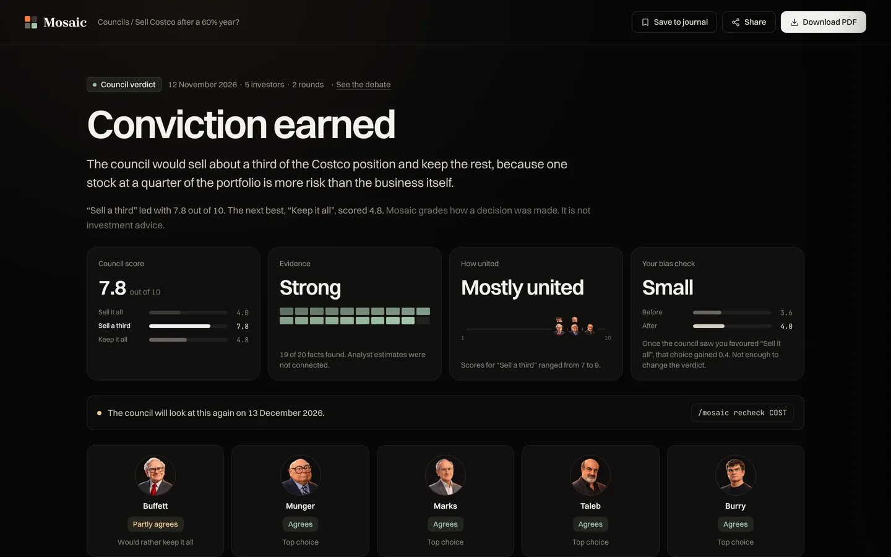

# How Mosaic works

## Words used here

- **Council**: the simulated investors on a decision.
- **Seat**: one simulated investor.
- **The Chair**: the coordinator that runs the rounds and writes the verdict. It never argues a side.
- **Fact sheet (data pack)**: the sourced numbers every seat argues from.
- **Lean**: which way you lean. It is hidden in Round 1.
- **Lean pull**: how far scores moved toward your lean after it was revealed.

## What makes it different

1. **One sourced fact sheet.** Every seat argues from the same `data-pack.json`. Every number has a fact id (`F014`), a source, an as-of date and a status. Missing data stays visibly missing, never filled in. A check script fails any cited fact id or quote that is not real.
2. **Real debate, dissent kept.** Seats answer each other's strongest argument. The verdict leads with where they disagree and keeps the minority report. No averaging into "hold".
3. **It remembers.** Each decision becomes a thesis journal entry with kill criteria and a re-check date. `/mosaic recheck NVDA` reruns a quick council on what changed since the last pack.
4. **Anti-sycophancy.** Round 1 seats do not know which way you lean. The lean is revealed in Round 2, and the verdict reports the **lean pull**: how far scores moved toward your lean after the reveal.

## What it can look at

Mosaic handles four jobs: a **decision** on one ticker (buy, add, hold, trim, sell), a **thesis stress test** (pre-mortem and "I'm wrong if" conditions), a **portfolio review** (concentration, correlated bets and ruin exposure, as education) and a **macro question** (curve, policy rate, inflation, labor, credit).

Verdict labels grade the decision: **CONVICTION EARNED**, **PROCEED WITH CONDITIONS**, **RESHAPE THE THESIS**, **PASS**, plus **WAIT FOR THE PITCH** and **INSUFFICIENT EVIDENCE**. The math is in [`skills/mosaic/references/scoring.md`](../skills/mosaic/references/scoring.md).

To choose the investors yourself, add `--seats buffett,taleb,marks`. To seat everyone (up to nine), add `--all`.

## How a council runs

1. **Intake**: the Chair classifies the job, builds the options (always including "don't act"), and asks once for anything missing. Your lean is recorded and withheld.
2. **Data pack**: `node data/cli.mjs pack` writes `data-pack.json` and a readable `data-pack.md` with a data-health table and per-seat evidence.
3. **Round 1, blind**: every seat answers in parallel on the evidence alone. A seat may say TOO HARD and abstain.
4. **Round 2, debate**: the lean is revealed. Seats rebut each other, concede, and rescore.
5. **Draft and Round 3**: conditions, pre-mortem, kill criteria, re-check date. Seats rescore the options and endorse, amend or dissent in their own words. Whether each seat agrees is derived from its scores.
6. **Verify**: `scripts/check-citations.mjs` checks every quote against the seat's brain and every fact id against the pack.
7. **Verdict**: `scripts/score.mjs` computes the label and the numbers. The Chair writes `verdict.md`, checks it with `check-citations.mjs` again, writes `verdict.json`, and journals it.

Session file formats (the contract the Room reads) are in [`skills/mosaic/references/live-room.md`](../skills/mosaic/references/live-room.md).

## The Room

The Room is a local web page that plays a council live, then shows the verdict. It reads the session files the council writes and makes no AI calls. It needs Node 20 or later and nothing else.



In Claude Code, `/mosaic room` starts it. Without Claude Code, run this inside the `mosaic` folder:

```bash
node room/server.js --open
```

`--open` opens your browser. The address is http://localhost:4731.

- Until you have a council of your own, the Room shows the newest example council. The Journal page lists all three examples to open.
- If port 4731 is taken by something else, the Room moves to the next free port and prints the address. If a Room is already open, it says so.
- To pick a port, use `--port 4800` or set `MOSAIC_ROOM_PORT`.
- To open one finished example, run this inside the `mosaic` folder:

```bash
node room/server.js --session room/examples/2026-11-17-nvda-buy
```

- To watch your own councils, run this inside the `mosaic` folder. Use the `home` that `node data/cli.mjs paths` prints:

```bash
node room/server.js --home <home>
```

Without `--session`, the Room follows the newest council in that home's `sessions/` folder, so a council started after the Room opens shows up by itself. Other options are `--plugin-data`, `--sessions`, `--journal` and `--roster`.

Three finished councils in `room/examples/` run with no live council: a buy (NVIDIA), a sell (Costco) and a sizing decision (Microsoft). The Room's tests run with the rest under `npm test`. Its browser tests need Playwright and skip themselves without it.

## Where your data lives

Sessions, the journal, the cache, `.env.local` and `mosaic.config.json` live in `~/.mosaic`. On Windows that is `C:\Users\<you>\.mosaic`. This is the same for marketplace and clone installs. These files survive plugin updates and uninstalls.

- Set `MOSAIC_HOME` to use another folder.
- An older clone or plugin data folder that already holds sessions keeps being used.
- `/mosaic` pre-approves only its own five scripts (run as `node "<plugin folder>/<script>"`) and file reads and writes inside `~/.mosaic`, so a council runs without approval prompts. Anything else still asks, including other `node` commands. Details are in [marketplace-listing.md](marketplace-listing.md), under Security notes.
- To print the folders, run this inside the clone:

```bash
node data/cli.mjs paths
```

## What Mosaic runs and sends

- It runs only Node scripts that ship in the plugin. There are no npm packages, no postinstall step, no hooks and no MCP servers.
- The Room is a local web server bound to 127.0.0.1. It makes no AI calls.
- Network requests go only to the data sources below, and only when building a data pack:
  - `data.sec.gov` and `www.sec.gov`, with your SEC contact in the User-Agent, as the SEC requires
  - `query1.finance.yahoo.com`
  - `home.treasury.gov`
  - `markets.newyorkfed.org`
  - `api.bls.gov`
  - With a key you add: `api.stlouisfed.org` (FRED), `financialmodelingprep.com`, `finnhub.io` and `api.massive.com`
- Keys and the SEC contact are never written to packs, sessions or logs.
- Nothing is sent anywhere else. There is no telemetry.

[Back to the README](../README.md)
