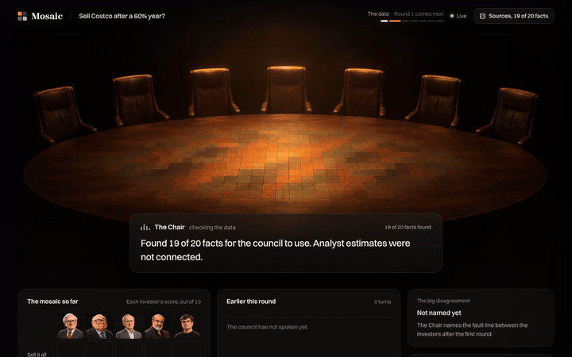
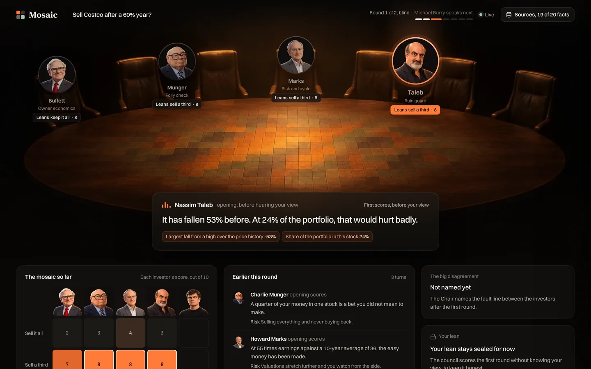
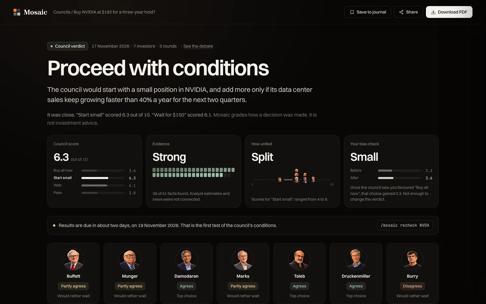
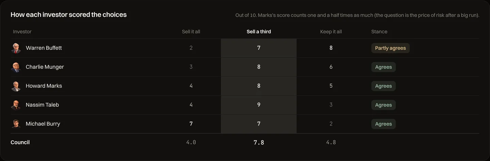
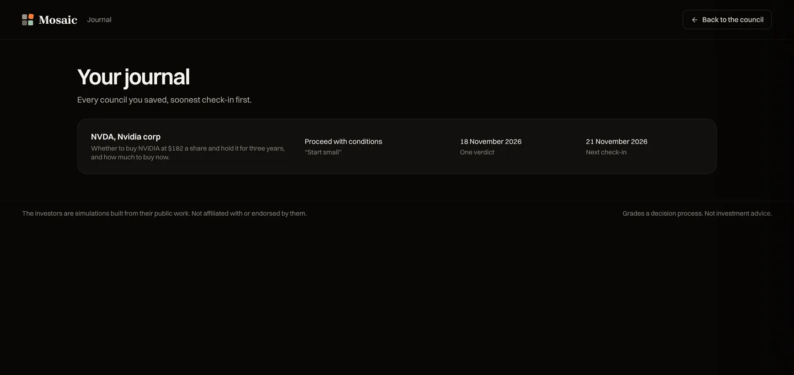
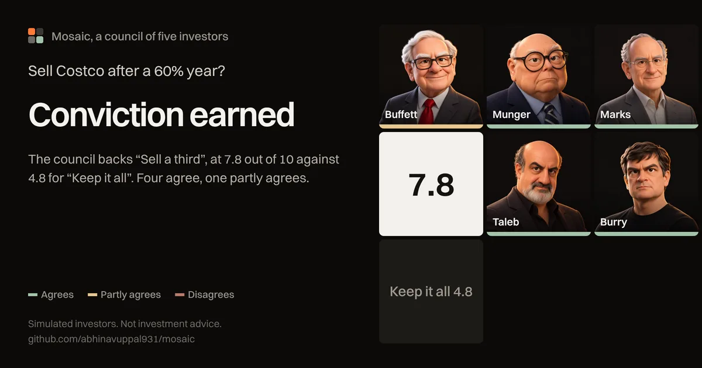
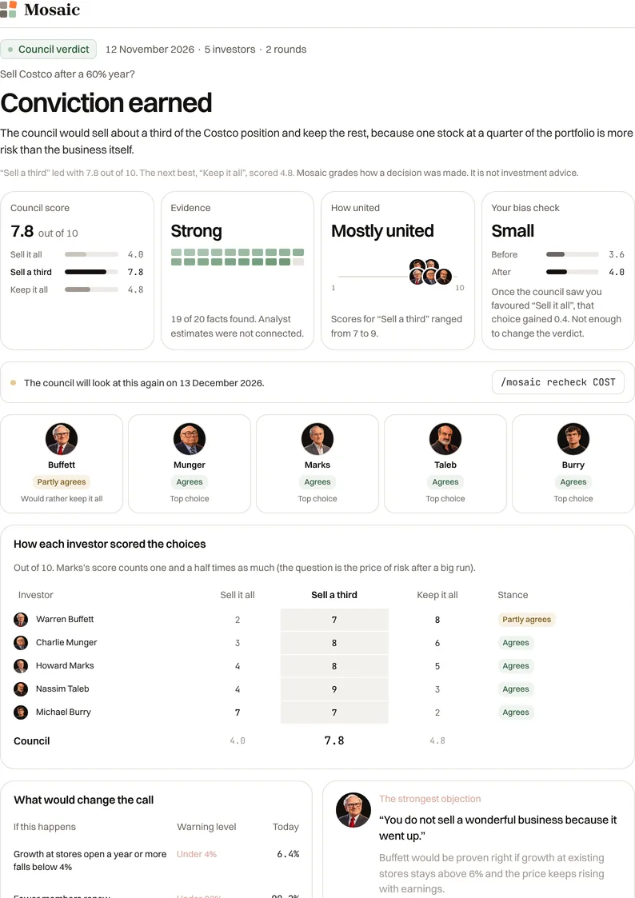
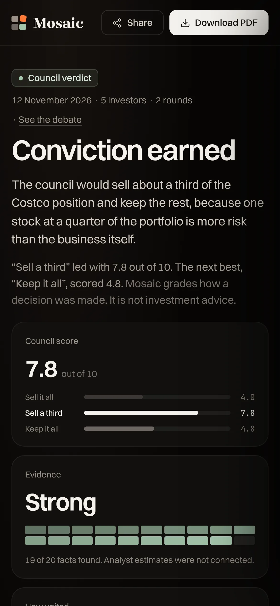

# A tour of Mosaic

What a council looks like, from install to a verdict you can share. Every screen below was captured from the real Room, using the three example councils that ship in `room/examples/`. To capture them again, run `npm run tour --prefix room` inside the clone.



The same recording as a video: [hero-loop.mp4](hero-loop.mp4).

## 1. Install

From any folder, in a terminal:

```bash
claude plugin install mosaic --marketplace abhinavuppal931/mosaic
```

Then start Claude Code with `claude` and type `/mosaic`. The README's [quick start](../README.md#quick-start) also covers installing from a git clone and installing from inside Claude Code.

## 2. First run

`/mosaic` checks Node, your Mosaic home and the SEC contact. Then it opens the Room and asks for your decision. Until you have a council of your own, the Room shows a finished example, so there is something to look at straight away.


The journal page lists all three examples: a buy (NVIDIA), a sell (Costco) and a sizing decision (Microsoft). Your first council replaces the example as soon as it starts.


## 3. Round 1, blind

You describe the decision in plain words, for example `/mosaic I plan to sell some of my Costco position after a 60% year`. The Chair builds one sourced fact sheet. Then every seat answers at the same time, without knowing which way you lean.



## 4. The debate

In Round 2 the Chair reveals your lean, and the seats answer each other's strongest point. The speaker is lit, and each fact chip under a line shows the number it cites from the fact sheet; hover to see its source. "The mosaic so far" updates as scores move.


## 5. The verdict

After Round 3, the Chair returns a graded verdict. It shows what the council would do, how close the vote was, how strong the evidence is, how split the seats were, and how far your lean pulled the scores. Each seat's vote is derived from its own scores.



The full page adds the scorecard, the strongest objection, how this could go wrong (the pre-mortem), what would change the call (the kill criteria) and the next check-in date. [See the whole page](tour/06-verdict-full.webp).



## 6. The journal and rechecks

Save a verdict and it joins your journal, with its next check-in date.



When results or news arrive, `/mosaic recheck COST` runs a quick council on what changed since the last fact sheet, tripped kill criteria first.


## 7. Share it

Share downloads a 1200 by 630 card of the verdict and copies a short text summary to your clipboard.



Download PDF prints the verdict with a print layout made for paper.



## 8. On a phone

The Room works at phone width too: the live debate on the left, and the verdict on the right.

<p>
  
  
</p>

---

Mosaic grades how a decision was made. It is not investment advice. The seats are simulations built from public work. They are not the people and do not speak for them.

Back to the [README](../README.md). Mosaic is made by Abhinav Uppal; more of his work is on [his website][site].

[site]: https://abhinav-uppal-website.vercel.app
