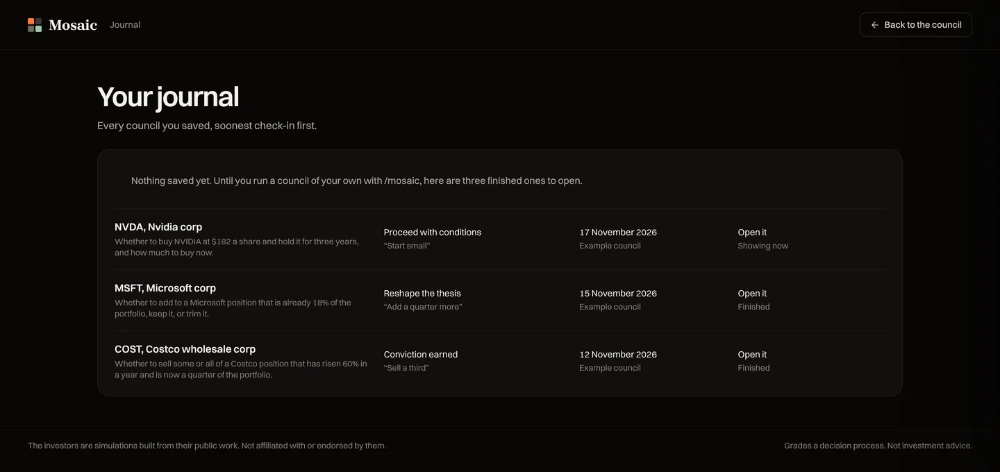
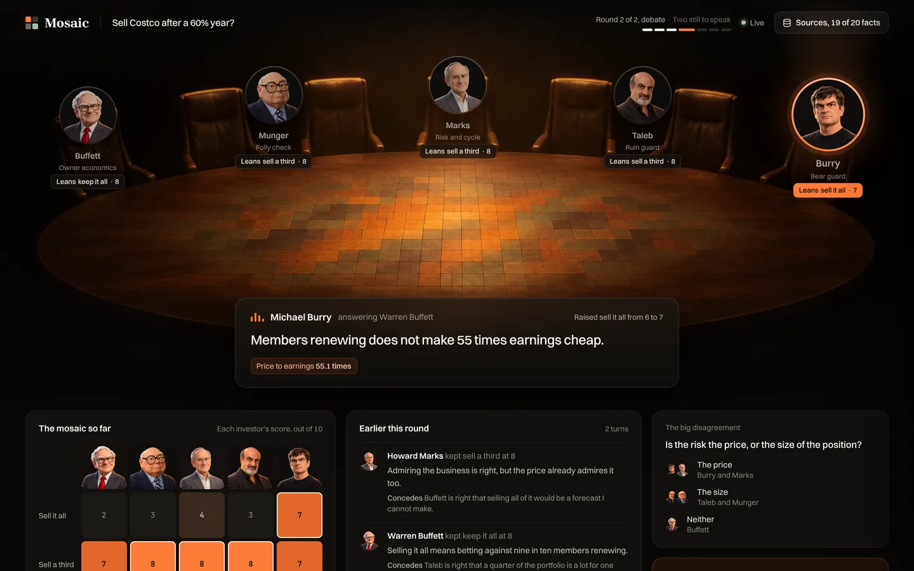
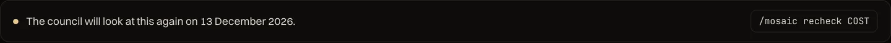
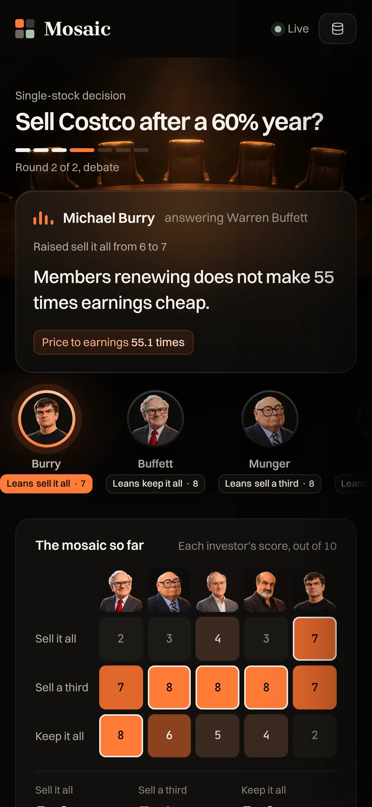

# A tour of Mosaic

From your first run to a verdict you can share, in one minute. To install it, see [Get started](../README.md#get-started).

## 1. First run

`/mosaic` checks your setup, then opens the Room on a finished example, so there is something to see straight away.

Three examples are ready to open: a buy, a sell and a sizing decision. Your own council replaces them as soon as it starts.

## 2. Round 1: answers before they know your view

Describe your decision in plain words, for example `/mosaic I plan to sell some of my Costco position after a 60% year`. Each investor answers from the same sourced numbers, before anyone knows which way you lean.

## 3. The debate

Then they answer each other's strongest point, and the scores move as they go. Hover over any number to see its source.

## 4. The verdict

A scored call that shows where they disagree, and whether knowing your view pulled them toward it.

Every investor's score for every option. Further down the page: what could go wrong, what would change the call, and when to look again. [See the whole page](tour/06-verdict-full.webp).

## 5. Your journal and rechecks

Save a verdict, and it waits in your journal with its next check-in date.

When news or results arrive, `/mosaic recheck COST` asks what changed since last time.

## 6. Share it

Share a card of the verdict.

Or keep it as a PDF.

## 7. On your phone

The debate and the verdict both fit a phone screen.

  
  

---

Simulated investors, built from public work. Not investment advice. Back to the [README](../README.md). More from Abhinav Uppal on [his website][site].

[site]: https://abhinav-uppal-website.vercel.app
